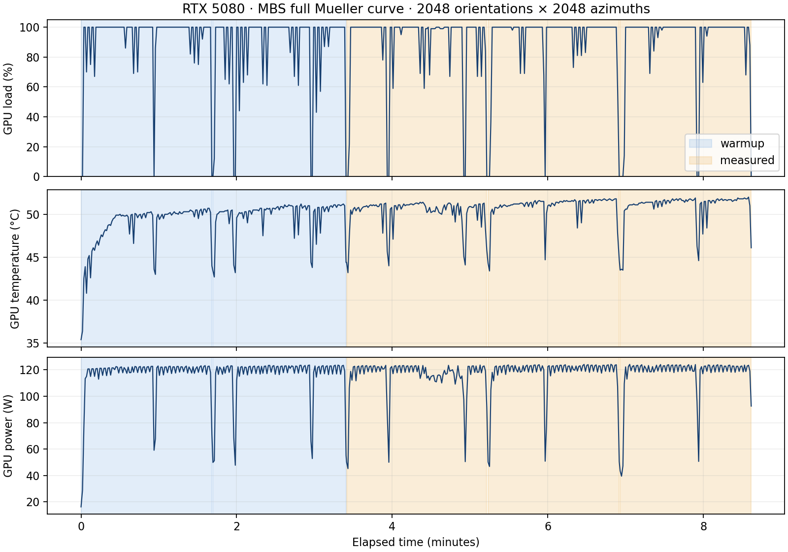

# RTX 5080: long MBS test, 2026-11-03

The full Mueller workload passes the FP64-reference and GPU-dominance gates.
This measurement used native revision `7ee3eb1`, runner `d133006`, CUDA 13.4.3
(nvcc 13.4.92), native sm_120, driver 621.01, and Ryzen 9 9950X3D / WSL2.
It measures `gpu-fp32-reduced`; it is not a measurement of the double-single
profile subsequently added to main. Exact sources, commands and binary hashes
are in [results.json](results.json) and the reference provenance.

| Quantity | Measured value |
|---|---:|
| Excluded thermal warmup | 204.573 s (two full processes) |
| Three measured processes | 108.914 / 101.688 / 102.100 s |
| Median / MAD | 102.100 / 0.412 s |
| Total measured work | 312.702 s |
| Median native CUDA kernel time / wall | 92.526% |
| Median GPU load in each repeat | 100% |
| Median temperature in repeats | 50.9 / 51.4 / 51.6 °C |
| Median GPU power in repeats | 118.8 / 122.7 / 122.6 W |
| Full-curve max abs(delta Mij)/M11_ref | 4.608e-7 |
| Full-curve relative L2 | 1.194e-7 |

The 261.714-second FP64 reference generation is separate from warmup and scoring;
its native CUDA kernels took 248.665 seconds, and CPU tracing took 1.924 seconds.
GPU load establishes duty cycle, not peak FLOP utilization or maximum board
power. MBS has a different arithmetic/memory mix from the BEM operator test.

The [isolation audit](isolation_audit.json) records that all MBS measurements
finished before the external production campaign started. This recorded runner
predates the continuous compute-PID guard now in the script. The later BEM run
that overlapped that campaign is discarded in BEM's report; it does not affect
these earlier MBS measurements.

[Per-repeat CSV](summary.csv) · [raw telemetry/provenance](results.json)

